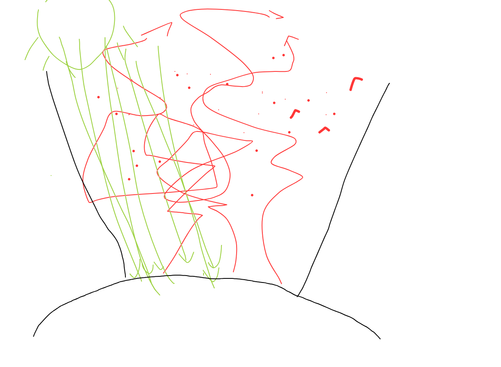

## forcejefikaj gasoj en la atmosfero

- co2 ktp en ppm?
- kiom absolute en tuta atm?

fontoj:
- https://en.wikipedia.org/wiki/Greenhouse_gas
- https://www.umweltbundesamt.de/daten/umweltzustand-trends/klima/atmosphaerische-treibhausgas-konzentrationen#lachgas
- https://www.ds.mpg.de/139645/08
- https://www.uni-flensburg.de/fileadmin/content/institute/biologie/arbeitsgruppe-christian/dokumente/projekte/der-norden-taucht-ab/03-klimawirksame-gase-und-der-treibhauseffekt-ursachen.pdf

## energikapacito relative n2, o2

- molekulformo difinas kiom da energio ĝi povas konservi
- energiniveloj difinas kiajn frekvencojn de fotonoj molekulo povas akcepti (absorbi)

## verda lumo de suno vs ruĝa lumo de tero

[Spektro de nigra radianto](https://reta-lernejo.github.io/fiziko/nigra_radianto.html)

Suna surfaco: 6000 K - maksimumo ĉe bluverda lumo
Tera surfaco: 300 K - maksimuma en infraruĝo

## atmosferaj fenestroj (spektrobendoj) de frekvenc-tralaso vs bloko

## radia ekvilbro 

https://de.wikipedia.org/wiki/Strahlungsgleichgewicht
(kun sen albedo kaj forceja efik.)

## simula modelo

<canvas id="kampo" width="500" height="500"></canvas>
simulado de ideala gaso

<button id="starto">Komencu</button>
<button id="halto">Haltu</button>

